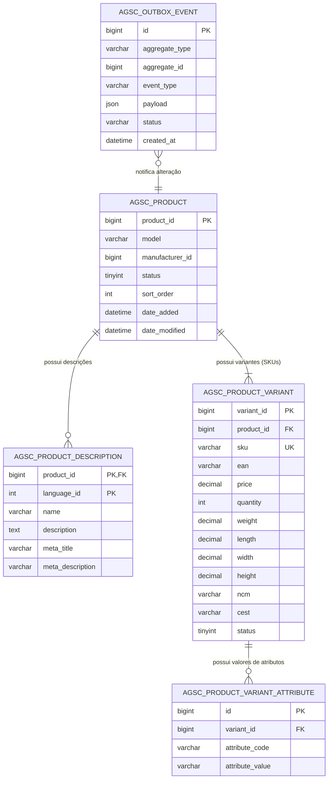
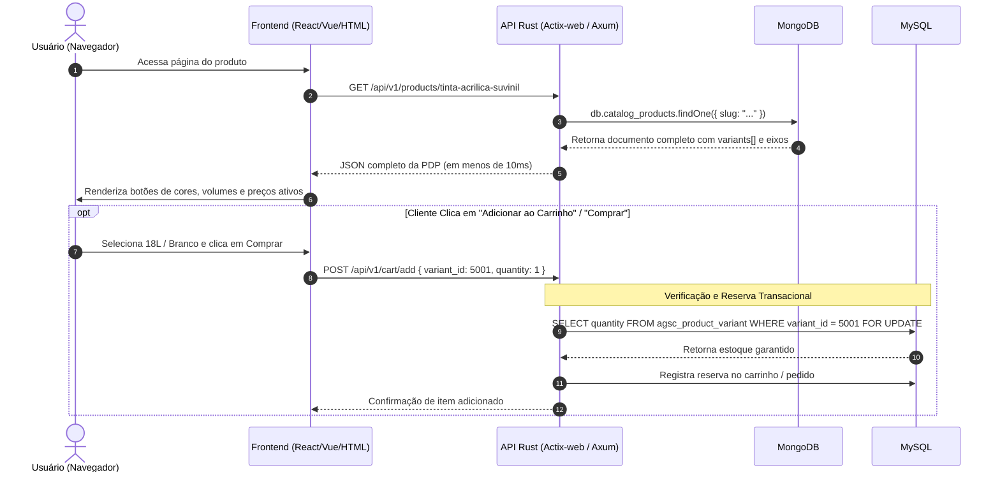

# Estruturas de Dados e Classes: Arquitetura Poliglota (MySQL + MongoDB)

Este documento especifica a modelagem de dados detalhada para o e-commerce de materiais de construção, partindo da estrutura relacional legada (`agsc_product`) e evoluindo para uma arquitetura poliglota com **MySQL** (transacional/fiscal) e **MongoDB** (catálogo de variantes e busca multifacetada), com implementações de referência em **Rust**.

---

## 1. Diagnóstico da Estrutura Relacional Legada

As tabelas originais (`agsc_product` e `agsc_product_description`) foram concebidas no modelo tradicional de e-commerce (como no OpenCart):

```
agsc_product (Tabela Original Plana):
  - product_id, model, sku, upc, ean, jan, isbn, mpn, location
  - variant, override, quantity, stock_status_id, image, manufacturer_id
  - shipping, price, points, tax_class_id, date_available
  - weight, weight_class_id, length, width, height, length_class_id
  - subtract, minimum, rating, sort_order, status, date_added, date_modified
  - ncm, cest
```

### Onde está o problema para Variação de Produtos?
No modelo plano acima, atributos críticos para transação e logística estão fixados no nível de **produto único**:
1. **Preço e Estoque (`price`, `quantity`):** Uma lata de tinta de $18\text{L}$ não custa o mesmo nem tem o mesmo estoque de uma de $900\text{ml}$;
2. **Frete e Logística (`weight`, `length`, `width`, `height`):** O peso de um tubo PVC de $110\text{mm}$ é drasticamente diferente de um de $20\text{mm}$;
3. **Identificação e Fiscal (`sku`, `ean`, `ncm`, `cest`):** Na legislação brasileira, cada variação física possui seu próprio código de barras EAN/GTIN e pode até possuir regras tributárias ou CEST específicos;
4. **Tentativa com colunas `variant` e `override`:** No modelo legado, isso é frequentemente tratado com flags booleanas e tabelas soltas de opções (`product_option`), gerando dezenas de consultas lentas e inconsistências.

---

## 2. Modelagem Relacional Normalizada (MySQL - Write Model)

Para suportar variações reais mantendo a integridade transacional, separamos o conceito em:
- **Produto Pai (Master / Agrupador):** Contém identidade conceitual, fabricante e regras gerais.
- **Variante do Produto (SKU Concreto):** Contém tudo o que é transacionável (preço, estoque, medidas, EAN, NCM).
- **Outbox:** Fila transacional para sincronização com o MongoDB.

### 2.1. Diagrama Entidade-Relacionamento (MySQL)



### 2.2. Script DDL (MySQL 8.0+)

```sql
-- 1. Produto Pai (Master / Agrupador)
CREATE TABLE agsc_product (
    product_id BIGINT AUTO_INCREMENT PRIMARY KEY,
    model VARCHAR(64) NOT NULL,
    manufacturer_id BIGINT DEFAULT NULL,
    shipping TINYINT(1) DEFAULT 1,
    status TINYINT(1) DEFAULT 1,
    sort_order INT DEFAULT 0,
    date_added DATETIME DEFAULT CURRENT_TIMESTAMP,
    date_modified DATETIME DEFAULT CURRENT_TIMESTAMP ON UPDATE CURRENT_TIMESTAMP,
    INDEX idx_model (model),
    INDEX idx_status (status)
) ENGINE=InnoDB DEFAULT CHARSET=utf8mb4 COLLATE=utf8mb4_unicode_ci;

-- 2. Descrições e Metadados (Multi-idioma / SEO)
CREATE TABLE agsc_product_description (
    product_id BIGINT NOT NULL,
    language_id INT NOT NULL,
    name VARCHAR(255) NOT NULL,
    description LONGTEXT,
    tag TEXT,
    meta_title VARCHAR(255),
    meta_description VARCHAR(255),
    meta_keyword VARCHAR(255),
    PRIMARY KEY (product_id, language_id),
    CONSTRAINT fk_desc_product FOREIGN KEY (product_id) 
        REFERENCES agsc_product (product_id) ON DELETE CASCADE
) ENGINE=InnoDB DEFAULT CHARSET=utf8mb4 COLLATE=utf8mb4_unicode_ci;

-- 3. Variantes Físicas Transacionáveis (SKUs Filhos)
CREATE TABLE agsc_product_variant (
    variant_id BIGINT AUTO_INCREMENT PRIMARY KEY,
    product_id BIGINT NOT NULL,
    sku VARCHAR(64) NOT NULL UNIQUE,
    ean VARCHAR(14) DEFAULT NULL,
    price DECIMAL(15, 4) NOT NULL DEFAULT 0.0000,
    quantity INT NOT NULL DEFAULT 0,
    weight DECIMAL(15, 4) DEFAULT 0.0000,
    weight_class_id INT DEFAULT 1,
    length DECIMAL(15, 4) DEFAULT 0.0000,
    width DECIMAL(15, 4) DEFAULT 0.0000,
    height DECIMAL(15, 4) DEFAULT 0.0000,
    length_class_id INT DEFAULT 1,
    ncm VARCHAR(10) DEFAULT NULL,
    cest VARCHAR(10) DEFAULT NULL,
    status TINYINT(1) DEFAULT 1,
    date_added DATETIME DEFAULT CURRENT_TIMESTAMP,
    date_modified DATETIME DEFAULT CURRENT_TIMESTAMP ON UPDATE CURRENT_TIMESTAMP,
    INDEX idx_sku (sku),
    INDEX idx_ean (ean),
    CONSTRAINT fk_variant_product FOREIGN KEY (product_id) 
        REFERENCES agsc_product (product_id) ON DELETE CASCADE
) ENGINE=InnoDB DEFAULT CHARSET=utf8mb4 COLLATE=utf8mb4_unicode_ci;

-- 4. Valores de Atributos Determinantes da Variante
CREATE TABLE agsc_product_variant_attribute (
    id BIGINT AUTO_INCREMENT PRIMARY KEY,
    variant_id BIGINT NOT NULL,
    attribute_code VARCHAR(32) NOT NULL, -- Ex: 'cor', 'voltagem', 'diametro', 'volume'
    attribute_value VARCHAR(128) NOT NULL, -- Ex: 'Branco Neve', '220V', '25mm', '18L'
    UNIQUE KEY uk_variant_attr (variant_id, attribute_code),
    INDEX idx_code_val (attribute_code, attribute_value),
    CONSTRAINT fk_attr_variant FOREIGN KEY (variant_id) 
        REFERENCES agsc_product_variant (variant_id) ON DELETE CASCADE
) ENGINE=InnoDB DEFAULT CHARSET=utf8mb4 COLLATE=utf8mb4_unicode_ci;

-- 5. Tabela de Outbox (Sincronização Assíncrona com MongoDB)
CREATE TABLE agsc_outbox_event (
    id BIGINT AUTO_INCREMENT PRIMARY KEY,
    aggregate_type VARCHAR(64) NOT NULL DEFAULT 'PRODUCT',
    aggregate_id BIGINT NOT NULL,
    event_type VARCHAR(64) NOT NULL, -- Ex: 'PRODUCT_CREATED', 'PRODUCT_UPDATED'
    payload JSON NOT NULL,
    status ENUM('PENDING', 'PROCESSING', 'COMPLETED', 'FAILED') DEFAULT 'PENDING',
    retry_count INT DEFAULT 0,
    created_at DATETIME DEFAULT CURRENT_TIMESTAMP,
    processed_at DATETIME DEFAULT NULL,
    INDEX idx_status_created (status, created_at)
) ENGINE=InnoDB DEFAULT CHARSET=utf8mb4 COLLATE=utf8mb4_unicode_ci;
```

---

## 3. Modelagem de Documentos (MongoDB - Read Model / Catálogo)

No MongoDB, os dados do produto pai, suas traduções, a lista de variantes ativas e a matriz combinatória são armazenados em um **único documento desnormalizado** na collection `catalog_products`.

### 3.1. Estrutura do Documento JSON/BSON (`catalog_products`)

```json
{
  "_id": "67098f9c1e7a4b810d9821a1",
  "product_id": 1042,
  "name": "Tinta Acrílica Premium Rende Muito",
  "model": "SUV-RENDE-MTO",
  "slug": "tinta-acrilica-premium-rende-muito",
  "category": {
    "id": 15,
    "name": "Pintura e Acessórios",
    "path": "Tintas > Tintas Imobiliárias > Acrílicas"
  },
  "manufacturer": {
    "id": 8,
    "name": "Suvinil"
  },
  "short_description": "Tinta acrílica lavável de alto rendimento e cobertura.",
  "status": "ACTIVE",
  
  "variation_axes": [
    {
      "code": "volume",
      "label": "Volume da Embalagem",
      "options": ["900ml", "3.6L", "18L"]
    },
    {
      "code": "acabamento",
      "label": "Acabamento da Superfície",
      "options": ["Fosco", "Acetinado"]
    },
    {
      "code": "cor",
      "label": "Tonalidade",
      "options": ["Branco Neve", "Palha", "Cinza Urbano"]
    }
  ],

  "variants": [
    {
      "variant_id": 5001,
      "sku": "SUV-RM-18L-FOS-BR",
      "ean": "7891234567890",
      "attributes": {
        "volume": "18L",
        "acabamento": "Fosco",
        "cor": "Branco Neve"
      },
      "price": 389.90,
      "in_stock": true,
      "weight_kg": 24.50,
      "dimensions": { "length": 32.0, "width": 32.0, "height": 38.0 },
      "image_url": "/images/products/suv-18l-branco.webp",
      "status": 1
    },
    {
      "variant_id": 5002,
      "sku": "SUV-RM-3.6L-FOS-BR",
      "ean": "7891234567891",
      "attributes": {
        "volume": "3.6L",
        "acabamento": "Fosco",
        "cor": "Branco Neve"
      },
      "price": 119.50,
      "in_stock": true,
      "weight_kg": 5.20,
      "dimensions": { "length": 18.0, "width": 18.0, "height": 22.0 },
      "image_url": "/images/products/suv-36l-branco.webp",
      "status": 1
    }
  ],

  "facets": {
    "volume": ["18L", "3.6L"],
    "acabamento": ["Fosco"],
    "cor": ["Branco Neve"],
    "min_price": 119.50,
    "max_price": 389.90
  },

  "updated_at": "2026-10-11T18:20:00Z"
}
```

### 3.2. Índices Recomendados no MongoDB

```javascript
// Busca rápida por ID do produto relacional
db.catalog_products.createIndex({ "product_id": 1 }, { unique: true });

// Busca por SKU específico da variante
db.catalog_products.createIndex({ "variants.sku": 1 });

// Busca por Código de Barras (EAN)
db.catalog_products.createIndex({ "variants.ean": 1 });

// Filtros multifacetados por categoria e atributos dinâmicos
db.catalog_products.createIndex({ 
    "category.id": 1, 
    "facets.volume": 1, 
    "facets.acabamento": 1,
    "facets.min_price": 1 
});

// Busca textual por nome do produto
db.catalog_products.createIndex({ "name": "text", "short_description": "text" });
```

---

## 4. Estruturas de Classes e Modelagem em Rust

No ecossistema Rust, usamos tipos estritos e seguros contra falhas de concorrência (`Thread-Safe`). A seguir estão os modelos de dados utilizando `sqlx`, `mongodb` e `serde`.

### 4.1. Modelos Relacionais (MySQL / `sqlx`)

```rust
use chrono::NaiveDateTime;
use rust_decimal::Decimal;
use serde::{Deserialize, Serialize};
use sqlx::FromRow;

/// Representa a tabela `agsc_product` (Mestre)
#[derive(Debug, Clone, Serialize, Deserialize, FromRow)]
pub struct ProductMasterRow {
    pub product_id: i64,
    pub model: String,
    pub manufacturer_id: Option<i64>,
    pub shipping: i8,
    pub status: i8,
    pub sort_order: i32,
    pub date_added: NaiveDateTime,
    pub date_modified: NaiveDateTime,
}

/// Representa a tabela `agsc_product_variant` (SKU Filho)
#[derive(Debug, Clone, Serialize, Deserialize, FromRow)]
pub struct ProductVariantRow {
    pub variant_id: i64,
    pub product_id: i64,
    pub sku: String,
    pub ean: Option<String>,
    pub price: Decimal,
    pub quantity: i32,
    pub weight: Decimal,
    pub weight_class_id: i32,
    pub length: Decimal,
    pub width: Decimal,
    pub height: Decimal,
    pub length_class_id: i32,
    pub ncm: Option<String>,
    pub cest: Option<String>,
    pub status: i8,
    pub date_added: NaiveDateTime,
    pub date_modified: NaiveDateTime,
}

/// Representa a tabela `agsc_product_variant_attribute`
#[derive(Debug, Clone, Serialize, Deserialize, FromRow)]
pub struct VariantAttributeRow {
    pub id: i64,
    pub variant_id: i64,
    pub attribute_code: String,
    pub attribute_value: String,
}

/// Representa a tabela `agsc_outbox_event`
#[derive(Debug, Clone, Serialize, Deserialize, FromRow)]
pub struct OutboxEventRow {
    pub id: i64,
    pub aggregate_type: String,
    pub aggregate_id: i64,
    pub event_type: String,
    pub payload: serde_json::Value,
    pub status: String,
    pub retry_count: i32,
    pub created_at: NaiveDateTime,
    pub processed_at: Option<NaiveDateTime>,
}
```

### 4.2. Modelos Orientados a Documento (MongoDB / `mongodb::bson`)

```rust
use mongodb::bson::oid::ObjectId;
use serde::{Deserialize, Serialize};
use std::collections::HashMap;

/// Documento principal na collection `catalog_products`
#[derive(Debug, Clone, Serialize, Deserialize)]
pub struct CatalogProductDocument {
    #[serde(rename = "_id", skip_serializing_if = "Option::is_none")]
    pub id: Option<ObjectId>,
    pub product_id: i64,
    pub name: String,
    pub model: String,
    pub slug: String,
    pub category: Option<CategoryInfo>,
    pub manufacturer: Option<ManufacturerInfo>,
    pub short_description: Option<String>,
    pub status: String,
    
    /// Eixos configuráveis para gerar a matriz de botões na interface
    pub variation_axes: Vec<VariationAxis>,

    /// Lista completa de SKUs concretos disponíveis
    pub variants: Vec<CatalogVariant>,

    /// Facetas pré-computadas para acelerar filtros de busca
    pub facets: HashMap<String, Vec<String>>,
    pub min_price: f64,
    pub max_price: f64,
}

#[derive(Debug, Clone, Serialize, Deserialize)]
pub struct CategoryInfo {
    pub id: i64,
    pub name: String,
    pub path: String,
}

#[derive(Debug, Clone, Serialize, Deserialize)]
pub struct ManufacturerInfo {
    pub id: i64,
    pub name: String,
}

#[derive(Debug, Clone, Serialize, Deserialize)]
pub struct VariationAxis {
    pub code: String,
    pub label: String,
    pub options: Vec<String>,
}

#[derive(Debug, Clone, Serialize, Deserialize)]
pub struct CatalogVariant {
    pub variant_id: i64,
    pub sku: String,
    pub ean: Option<String>,
    /// Mapa chave-valor de atributos (ex: {"volume": "18L", "cor": "Branco"})
    pub attributes: HashMap<String, String>,
    pub price: f64,
    pub in_stock: bool,
    pub weight_kg: f64,
    pub dimensions: Dimensions,
    pub image_url: Option<String>,
    pub status: i8,
}

#[derive(Debug, Clone, Serialize, Deserialize)]
pub struct Dimensions {
    pub length: f64,
    pub width: f64,
    pub height: f64,
}
```

### 4.3. Exemplo de Projeção em Rust (Transformando MySQL em MongoDB)

O trecho abaixo exemplifica a lógica executada pelo worker de sincronização em Rust:

```rust
use std::collections::{HashMap, HashSet};

/// Constrói o documento denormalizado do MongoDB a partir dos registros do MySQL
pub fn build_catalog_projection(
    master: &ProductMasterRow,
    name: &str,
    slug: &str,
    variants: &[ProductVariantRow],
    attributes_by_variant: &HashMap<i64, Vec<VariantAttributeRow>>,
) -> CatalogProductDocument {
    let mut catalog_variants = Vec::new();
    let mut facets_map: HashMap<String, HashSet<String>> = HashMap::new();
    let mut min_price = f64::MAX;
    let mut max_price = 0.0;

    for v in variants {
        let price_f64 = v.price.to_string().parse::<f64>().unwrap_or(0.0);
        if price_f64 < min_price { min_price = price_f64; }
        if price_f64 > max_price { max_price = price_f64; }

        let mut attrs_map = HashMap::new();
        if let Some(attrs) = attributes_by_variant.get(&v.variant_id) {
            for attr in attrs {
                attrs_map.insert(attr.attribute_code.clone(), attr.attribute_value.clone());
                
                // Agrupa para montar as facetas
                facets_map
                    .entry(attr.attribute_code.clone())
                    .or_default()
                    .insert(attr.attribute_value.clone());
            }
        }

        catalog_variants.push(CatalogVariant {
            variant_id: v.variant_id,
            sku: v.sku.clone(),
            ean: v.ean.clone(),
            attributes: attrs_map,
            price: price_f64,
            in_stock: v.quantity > 0,
            weight_kg: v.weight.to_string().parse::<f64>().unwrap_or(0.0),
            dimensions: Dimensions {
                length: v.length.to_string().parse::<f64>().unwrap_or(0.0),
                width: v.width.to_string().parse::<f64>().unwrap_or(0.0),
                height: v.height.to_string().parse::<f64>().unwrap_or(0.0),
            },
            image_url: None,
            status: v.status,
        });
    }

    // Converte os conjuntos de facetas em vetores ordenados
    let facets: HashMap<String, Vec<String>> = facets_map
        .into_iter()
        .map(|(k, v)| {
            let mut list: Vec<String> = v.into_iter().collect();
            list.sort();
            (k, list)
        })
        .collect();

    CatalogProductDocument {
        id: None,
        product_id: master.product_id,
        name: name.to_string(),
        model: master.model.clone(),
        slug: slug.to_string(),
        category: None,
        manufacturer: None,
        short_description: None,
        status: if master.status == 1 { "ACTIVE".to_string() } else { "INACTIVE".to_string() },
        variation_axes: Vec::new(),
        variants: catalog_variants,
        facets,
        min_price: if min_price == f64::MAX { 0.0 } else { min_price },
        max_price,
    }
}
```

---

## 5. Fluxo de Execução da Consulta na Interface Web (PDP)

Quando o usuário entra na página de detalhes de um produto (ex: `/produto/tinta-acrilica-suvinil`):



---

## 6. Resumo das Decisões de Design para Apresentação Acadêmica

1. **Separação de Preocupações:** O MySQL lida com a verdade matemática e fiscal da loja; o MongoDB lida com a experiência de navegação rica e sem atrito.
2. **Eliminação do EAV:** Nenhum join recursivo ou perda de tipagem ocorre na camada de leitura.
3. **Resiliência com Outbox Pattern:** Garante que mesmo em caso de reinicialização de contêineres ou falha de rede temporária no MongoDB, nenhum dado cadastrado pelo lojista seja perdido.
4. **Performance e Baixo Custo Computacional:** A leitura na PDP torna-se uma operação $O(1)$ por chave indexada.
