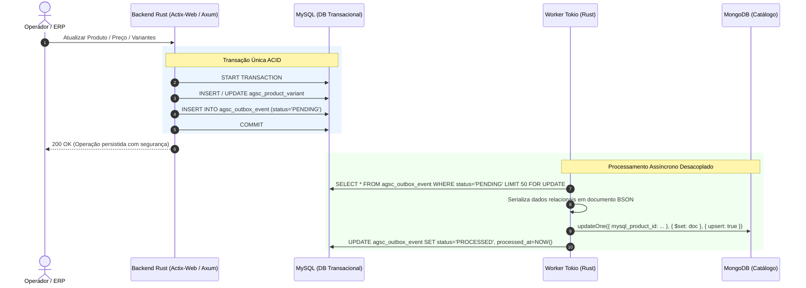

# Estudo Arquitetural: Implementação de Variações de Produtos e Melhores Estratégias para E-commerce de Materiais para Construção
**Persistência Poliglota: MySQL (Transacional / ACID) + MongoDB (Catálogo / Read Model) com Rust**

---

## 1. Contexto e Motivação do Negócio

O setor de **Materiais para Construção Civil** é amplamente reconhecido na engenharia de software e no comércio eletrônico como um dos domínios de catálogo mais complexos e heterogêneos existentes. Diferente de e-commerces de vestuário (onde as variações se resumem quase sempre a *Tamanho* e *Cor*), uma loja de materiais de construção lida com:

1. **Produtos com unidades de medida e venda assimétricas:** Pisos precificados por metro quadrado ($m^2$), mas vendidos estritamente por caixa fechada; areia vendida por $m^3$, saco de 20kg ou caminhão; tubos vendidos em barras de 3m ou 6m.
2. **Matrizes multidimensionais de variantes:** Tintas que variam simultaneamente em *Volume*, *Acabamento* e *Família de Cor*, onde nem todas as combinações são fisicamente fabricadas.
3. **Atributos técnicos altamente específicos e não-padronizados:** Resistência ao desgaste (PEI), absorção de água, tipo de borda/junta, diâmetro nominal em milímetros ou polegadas, tensão elétrica, potência, pressão máxima de trabalho.
4. **Calculadoras contextuais integradas à experiência de compra:** Ferramentas dinâmicas de cálculo (ex.: calculadora de pisos e revestimentos, calculadora de demãos de tinta) que dependem diretamente de metadados técnicos do produto.

Este estudo analisa criticamente as estratégias de modelagem para suportar essas particularidades, avalia a viabilidade de bancos relacionais vs. orientados a documentos e detalha a arquitetura de **Persistência Poliglota** recomendada para o projeto.

---

## 2. Análise Detalhada dos Casos do Domínio de Materiais de Construção

Abaixo estão mapeadas as principais categorias com suas características técnicas, regras de agrupamento e impactos na experiência do cliente.

### 2.1. Pisos e Revestimentos Cerâmicos / Porcelanatos
Além das especificações cadastrais básicas (marca, modelo, peso), cada revestimento possui atributos técnicos que determinam sua correta aplicação:

* **Acabamento de Superfície:** Polido (brilhante/liso), Acetinado (fosco suave), Esmaltado, Rústico / Granilhado / Granulado (antiderrapante para áreas externas).
* **Tipo de Borda & Junta de Assentamento:**
  * *Retificado (Borda Reta):* Permite juntas mínimas menores (ex.: $1{,}0\text{ mm}$ a $1{,}5\text{ mm}$), proporcionando efeito visual contínuo.
  * *Bold (Borda Arredondada/Tradicional):* Exige juntas de assentamento maiores (ex.: $3{,}0\text{ mm}$ a $5{,}0\text{ mm}$).
* **Variação de Tonalidade (Classes V):**
  * $V1$ (Aparência uniforme): Peças com mínima ou nenhuma diferença visual.
  * $V2$ (Variação leve): Diferenças sutis e perceptíveis na mesma cor.
  * $V3$ (Variação moderada): As cores presentes numa única peça indicam a cor das demais, mas o desenho varia.
  * $V4$ (Variação aleatória): Peças propositalmente distintas entre si para simular pedras ou madeiras naturais.
* **Resistência ao Desgaste Superficial (Índice PEI) e Classe de Uso:**
  * $PEI\ 1$ e $PEI\ 2$: Baixo tráfego (quartos e banheiros residenciais).
  * $PEI\ 3$: Tráfego médio (todas as dependências residenciais sem acesso direto à rua).
  * $PEI\ 4$: Alto tráfego (residências com acesso direto à rua, garagens e pequenos comércios).
  * $PEI\ 5$: Tráfego intensivo (shoppings, aeroportos, restaurantes).
  * *Porcelanatos Técnicos:* Não usam PEI; utilizam classes de tráfego/abrasão profunda.
* **Absorção de Água e Expansão por Umidade (EPU):**
  * *Porcelanatos (Grupo BIa):* Absorção $\le 0{,}5\%$ (alta resistência mecânica e ao congelamento/intempéries).
  * *Grés / Semi-grés (Grupo BIIa/BIIb):* Absorção média ($3\%$ a $10\%$).
  * *Monoporosa / Cerâmica tradicional (Grupo BIII):* Absorção $> 10\%$ (indicado apenas para paredes internas).
* **Agrupamento por Família / Coleção:**
  Uma mesma família de design (ex.: "Mármore Calacatta") compartilha o padrão visual, mas ramifica-se em:
  * Dimensões diferentes ($60\times60\text{ cm}$, $84\times84\text{ cm}$, $120\times120\text{ cm}$);
  * Versão Polida para salas/quartos internos;
  * Versão Rústica/EXT com alto coeficiente de atrito para decks e bordas de piscina.

### 2.2. Tubos, Conexões e Hidráulica
* **Eixos de Variação:**
  * *Diâmetro Nominal (DN):* $20\text{ mm}$ ($1/2"$), $25\text{ mm}$ ($3/4"$), $32\text{ mm}$ ($1"$), $40\text{ mm}$ ($1.1/4"$), $50\text{ mm}$ ($1.1/2"$), $60\text{ mm}$, $75\text{ mm}$, $85\text{ mm}$, $110\text{ mm}$.
  * *Ângulo da Conexão:* $45^\circ$, $90^\circ$, Curva Longa vs. Curva Curta.
  * *Tipo de Junta:* Soldável a frio (adesivo plástico), Roscável (BSP), Junta Elástica com Anel de Borracha, Termofusão (PPR) ou Crimpagem mecânica (PEX).
* **Atributos Técnicos:**
  * Linha de aplicação: Água Fria, Água Quente, Esgoto Série Normal (SN), Esgoto Série Reforçada (SR), Drenagem pluvial, Incêndio.
  * Classe de Pressão: $PN\ 10$, $PN\ 16$, $PN\ 20$ ou Classe 15.

### 2.3. Chuveiros, Duchas e Metais Sanitários
* **Eixos de Variação:**
  * *Tensão Elétrica:* $127\text{ V}$, $220\text{ V}$.
  * *Potência Elétrica Nominal:* $5500\text{ W}$, $6800\text{ W}$, $7500\text{ W}$, $7800\text{ W}$.
  * *Acabamento / Cor:* Cromado, Preto Fosco (*Black Matte*), Dourado (*Gold*), Rosé Gold, Branco.
* **Atributos Técnicos:**
  * Presença de pressurizador interno embutido (modelos com turbo vs. sem turbo);
  * Sistema de controle de temperatura: Multitemperaturas (chave mecânica 3 ou 4 posições) vs. Eletrônico (haste gradual linear contínua);
  * Compatibilidade com aquecimento solar e a gás.

### 2.4. Tintas, Vernizes e Impermeabilizantes
* **Eixos de Variação (Matriz Tridimensional):**
  * *Volume / Embalagem:* $900\text{ ml}$ (Quarto de galão), $3{,}6\text{ L}$ (Galão), $18\text{ L}$ (Lata industrial).
  * *Acabamento:* Fosco (disfarça imperfeições da parede), Acetinado (toque sedoso, lavável), Semibrilho (alta refletância e facilidade de limpeza).
  * *Família de Cor:* Tons Claros (Branco Neve, Gelo, Algodão), Tons Neutros (Palha, Camurça), Tons Médios/Escuros (Cinza Crômio, Grafite, Chumbo).
* **Atributos Técnicos:**
  * Rendimento de referência ($m^2$ por demão ou rendimento acabado por embalagem);
  * Número de demãos recomendadas pelo fabricante;
  * Tipo de base: Solvente base água (acrílica/látex) vs. Base solvente (esmalte sintético, epóxi);
  * Nível de lavabilidade e resistência a mofo/intempéries.

---

## 3. Análise Crítica da Hipótese: "MySQL para Produtos Simples e MongoDB para Variações"

### 3.1. A Ideia Proposta
> *"Produtos sem variações: tabela normal no MySQL.*  
> *Produtos com variações: Tabela do produto pai em MySQL, e variação em MongoDB, onde a busca do produto pai traria as variações preenchendo a página do produto."*

### 3.2. Por que essa separação binária gera sérios débitos técnicos?

Embora intuitiva à primeira vista, essa divisão cria problemas críticos na arquitetura de um e-commerce:

```
[HIPÓTESE BINÁRIA INICIAL - PROBLEMAS DE CONSISTÊNCIA]
  ┌─────────────────────────────────────────────────────────────┐
  │                 Aplicação / Backend                         │
  └──────────────┬───────────────────────────────┬──────────────┘
                 │ (if sem variação)             │ (if com variação)
                 ▼                               ▼
       ┌──────────────────┐            ┌──────────────────┐
       │   MySQL Puro     │            │ MongoDB Variação │
       │ (Estoque/Preço)  │            │ (Estoque/Preço?) │
       └──────────────────┘            └──────────────────┘
       * Regras de checkout duplicadas
       * Inconsistência de concorrência e trava de estoque
       * Quebra quando produto simples ganha nova variação
```

1. **Assimetria no Checkout e Transações de Estoque:**
   Para o carrinho de compras, faturamento e estoque, **todo item vendido é um SKU concreto**. Se um saco de cimento 50kg (produto simples) fica no MySQL e uma lata de tinta 18L (variante) fica no MongoDB, o motor de checkout precisará de dois fluxos de reserva de estoque completamente diferentes.
   * O MySQL garante transações com trava de linha (`SELECT ... FOR UPDATE`), impedindo que dois clientes comprem a mesma última unidade (*over-selling*).
   * Se o estoque de variantes estiver no MongoDB sem transações distribuídas, perde-se a garantia ACID estrita e a integridade com pedidos fiscais.

2. **Dificuldade na Evolução do Catálogo (Mutabilidade de Domínio):**
   Um produto que hoje nasce como "simples" (ex.: uma argamassa cinza de 20kg) pode ter amanhã a introdução da versão branca de 20kg. Se o modelo separar produtos simples de produtos variáveis em bancos diferentes, essa mudança exigirá migrar o registro de banco, quebrando histórico de pedidos, chaves estrangeiras e integridade referencial.

3. **Duplicação de Código no Backend:**
   O backend precisará ter validações bifurcadas para busca, cálculo de frete, aplicação de cupons e inventário.

### 3.3. A Abordagem Recomendada: Padrão Mestre-Variante Unificado com Persistência Poliglota

A melhor prática da indústria não é segregar "produtos com variação" de "produtos sem variação", mas sim **unificar a taxonomia relacional** e usar os bancos conforme seus pontos fortes via padrão **CQRS** (*Command Query Responsibility Segregation*):

```
[ARQUITETURA RECOMENDADA - PERSISTÊNCIA POLIGLOTA COM CQRS]

          ┌────────────────────────────────────────────────────────┐
          │                    API Backend (Rust)                  │
          └──────────────┬──────────────────────────┬──────────────┘
                         │                          │
              [Comandos / Transações]      [Consultas Rápidas / Catálogo]
                         │                          │
                         ▼                          ▼
         ┌──────────────────────────────┐   ┌──────────────────────────────┐
         │       MySQL (Write Model)    │   │     MongoDB (Read Model)     │
         │   (Fonte Única da Verdade)   │   │   (Catálogo Desnormalizado)  │
         │                              │   │                              │
         │ • agsc_product (Pai)         │   │ • Coleção catalog_products   │
         │ • agsc_product_variant (SKU) │   │ • Todos os produtos unificados│
         │ • Estoque físico e reserva   │   │ • Árvore de variantes pronta │
         │ • Preço base e fiscal (NCM)  │   │ • Metadados e specs técnicas │
         │ • Outbox de eventos          │   │ • Configuração de calculadora│
         └──────────────┬───────────────┘   └──────────────────────────────┘
                        │                                  ▲
                        └─────── [Worker Assíncrono] ──────┘
                                  (Transactional Outbox)
```

* **Regra Relacional (MySQL - Write Model):** **Todo produto vendável possui uma variante (SKU).**
  * Um produto "sem variações" (produto simples) é apenas um produto pai com exatamente **1 variante padrão** (relação 1:1).
  * Um produto com variações possui **$N$ variantes** associadas ao mesmo produto pai (relação 1:N).
  * Dessa forma, o carrinho, o frete, o estoque e a nota fiscal consultam **sempre** a tabela `agsc_product_variant`.
* **Regra Documental (MongoDB - Read Model):** O MongoDB armazena o catálogo completo pronto para visualização.
  * O MongoDB recebe um documento desnormalizado para **cada produto pai**, contendo dentro de si o array com todas as suas variantes ativas e todos os atributos dinâmicos.
  * Com **uma única query** (`db.catalog_products.findOne({ slug: ... })`), a página de detalhes do produto (PDP) obtém tudo o que precisa para renderizar seletores, imagens, especificações e calculadoras.

---

## 4. Comparativo das Estratégias de Modelagem de Variações

### 4.1. A Abordagem Alternativa: Produtos Planos com Agrupamento por Similaridade e Matriz JSON (*Sibling Products / JSON Manifest Pattern*)

Uma técnica bastante difundida no mercado — adotada em frameworks headless, plataformas como Shopify/Shopware e arquiteturas Jamstack — é o chamado **Padrão de Produtos Planos / Irmãos com Matriz JSON de Agrupamento**:

```
[MODELO DE PRODUTOS IRMÃOS COM MANIFESTO/MATRIZ JSON]

    Tabela MySQL (products):
    ┌────┬─────────────────────────────┬───────────┬──────────────┬────────┬─────────┐
    │ id │ nome                        │ family_id │ sku          │ preco  │ estoque │
    ├────┼─────────────────────────────┼───────────┼──────────────┼────────┼─────────┤
    │ 1  │ Tinta Acrílica Fosca 3,6L   │ TINT-100  │ TINT-3.6-FOS │ 119.90 │   25    │
    │ 2  │ Tinta Acrílica Fosca 18L    │ TINT-100  │ TINT-18-FOS  │ 429.00 │    8    │
    │ 3  │ Tinta Acrílica Semibrilho 18L│ TINT-100 │ TINT-18-SEMI │ 459.00 │    3    │
    └────┴─────────────────────────────┴───────────┴──────────────┴────────┴─────────┘
                                   │
                     Exportação / Geração da Matriz
                                   │
                                   ▼
          Arquivo JSON Estático (CDN/S3) ou Coluna JSON de Família:
          ┌─────────────────────────────────────────────────────────────┐
          │ {                                                           │
          │   "family_id": "TINT-100",                                  │
          │   "title": "Tinta Acrílica Lavável Rende Muito",            │
          │   "axes": ["volume", "finish"],                             │
          │   "variations_matrix": [                                    │
          │     { "product_id": 1, "volume": "3.6L", "finish": "Fosco",  │
          │       "price": 119.90, "in_stock": true },                  │
          │     { "product_id": 2, "volume": "18L", "finish": "Fosco",   │
          │       "price": 429.00, "in_stock": true }                   │
          │   ]                                                         │
          │ }                                                           │
          └─────────────────────────────────────────────────────────────┘
```

#### Como essa técnica funciona na prática?
1. **No MySQL (Sem hierarquia Pai/Filho rígida):** Cada variação é cadastrada como um produto autônomo e de primeira classe na tabela `products`. Cada registro tem seu próprio `id`, `sku`, `preco`, `estoque`, `ncm`, `peso` e dimensões de frete.
2. **Agrupamento por Chave de Similaridade (`family_id` / `group_code`):** Os produtos que compartilham a mesma essência recebem o mesmo código de família (ex.: `family_id = 'PORC-CALACATTA'` ou `'TINT-RENDE-MUITO'`).
3. **O Arquivo JSON / Manifesto de Variações:**
   * **Opção em Arquivo Estático (CDN / S3 / Cache):** Ao salvar um produto no MySQL, um script/worker gera um arquivo `.json` estático por família (ex.: `/static/catalogo/familias/tinta-rende-muito.json`). O frontend baixa esse arquivo diretamente da CDN. Ao clicar nos seletores de acabamento ou volume, o JavaScript em memória faz a correlação instantânea, trocando foto, preço e `product_id` sem fazer nenhuma requisição ao banco de dados.
   * **Opção em Coluna JSON no MySQL:** Mantém-se uma tabela auxiliar `product_family` contendo uma coluna `matrix_json` com o mapa consolidado dos SKUs irmãos.

#### Vantagens dessa técnica:
* **Simplicidade Absoluta no Checkout e ERP:** Como cada variante é uma linha completa e independente no MySQL, o carrinho de compras, a reserva de estoque e a integração com emissor de NF-e não precisam lidar com polimorfismo ou tabelas de relacionamento complexas.
* **Velocidade Extrema na PDP (Troca de Variações):** Com a matriz JSON em memória ou servida por CDN, o cliente clica nas opções de variação com resposta de $0\text{ ms}$, sem sobrecarregar o banco de dados.
* **SEO e Vitrine Flexíveis:** Uma variante pode ser promovida como produto avulso no Google Shopping ou aparecer agregada na listagem de categorias, bastando filtrar por `DISTINCT family_id`.

#### Desvantagens e Gargalos:
* **Invalidação e Desatualização de Cache do JSON:** Se o estoque de um produto zera ou o preço muda no ERP, o arquivo JSON estático precisa ser regerado e o cache da CDN purgado. Caso contrário, o cliente verá "em estoque" no JSON da tela, mas sofrerá rejeição ao tentar fechar o pedido no carrinho.
* **Dificuldade em Filtros e Buscas Facetadas no Catálogo:** Fazer buscas combinadas ("pisos retificados + PEI 4 + tamanho 84x84") dentro de colunas ou arquivos JSON no MySQL torna-se lento em catálogos grandes, exigindo a criação manual de índices funcionais virtuais.
* **Conexão com a Persistência Poliglota:** Na verdade, o uso do **MongoDB como Read Model** é a evolução natural dessa técnica. O MongoDB atua justamente como o repositório dessa "Matriz JSON de Agrupamento", porém com as vantagens de um banco de dados real: suporte nativo a índices secundários, consultas em tempo real, consistência eventual orquestrada via Outbox e sem a complexidade de ter que gerenciar milhares de arquivos `.json` físicos em disco ou buckets de S3.

---

### 4.2. Matriz Comparativa Completa das Abordagens

A tabela abaixo compara as abordagens possíveis para resolver variações em e-commerce de materiais para construção:

| Critério | 1. Relacional EAV Puro | 2. Tabelas Especializadas / Colunas Esparsas | 3. MySQL Flat + Matriz JSON (Arquivos/Coluna) | 4. MongoDB Puro | 5. Persistência Poliglota (MySQL + MongoDB) |
| :--- | :---: | :---: | :---: | :---: | :---: |
| **Performance de Leitura na PDP** | Baixa (5 a 8 JOINs por produto) | Média (depende da taxonomia) | **Excelente** (JSON estático / cache) | **Excelente** (Agregado único em $O(1)$) | **Excelente** (Leituras no Mongo sem travas de banco) |
| **Filtros Facetados (Busca de Catálogo)** | Complexa e lenta | Rápida, mas rígida | Fraca (pesquisas em JSON no MySQL são lentas) | **Excelente** (Índices multinível e textuais) | **Excelente** (MongoDB atende todo o catálogo) |
| **Integridade de Estoque e ACID** | **Alta** (ACID nativo) | **Alta** (ACID nativo) | **Alta** (Cada SKU é linha nativa no MySQL) | Média (exige transações documentais manuais) | **Alta** (Garantida pelo MySQL com `FOR UPDATE`) |
| **Flexibilidade de Atributos** | Alta (porém perde tipagem) | Baixa (exige `ALTER TABLE` contínuo) | Média/Alta (JSON armazena specs) | **Máxima** (Schemaless / BSON) | **Máxima** (MongoDB absorve novos campos sem migrations) |
| **Complexidade de Cache / Invalidação** | Baixa | Baixa | **Alta** (Necessita regerar arquivos JSON / CDN) | Baixa (Atualização via documento) | Média (Sincronização assíncrona Outbox) |
| **Complexidade Operacional** | Baixa (1 banco) | Baixa (1 banco) | Média (Gerenciamento de arquivos JSON / CDN) | Média (1 banco NoSQL com ACID) | Média/Alta (2 bancos + Worker Outbox) |
| **Adequação ao Nicho de Construção** | Ruim | Inviável a longo prazo | Boa para PDPs, fraca para filtros | Boa, mas arriscada em estoque | **Ideal para escala e robustez** |

---

## 5. A Calculadora de Materiais como Diferencial de Negócio e UX

No segmento de materiais de construção, a conversão de vendas é diretamente impactada por ferramentas que auxiliam o consumidor ou empreiteiro a calcular a quantidade correta de insumos.

### 5.1. O Desafio da Calculadora de Pisos e Revestimentos
O cliente mede a sala em metros quadrados (ex.: $25\text{ m}^2$), mas o fabricante vende o porcelanato em caixas fechadas com metragens não-inteiras (ex.: $2{,}14\text{ m}^2$ por caixa).

Além disso, nenhuma obra assenta piso sem perdas por recortes, quebras e rodapés:
* **Assentamento Reto (Tradicional):** Perda técnica estimada em $10\%$.
* **Assentamento Diagonal ou Espinha de Peixe:** Perda técnica estimada em $15\%$ a $20\%$.

#### Fórmula de Negócio Implementada:
$$\text{Área Efetiva} = \text{Área Informada} \times (1 + \frac{\text{Margem Perda \%}}{100})$$

$$\text{Quantidade de Caixas} = \left\lceil \frac{\text{Área Efetiva}}{\text{Rendimento por Caixa }(m^2)} \right\rceil$$

$$\text{Metragem Total a Faturar} = \text{Quantidade de Caixas} \times \text{Rendimento por Caixa }(m^2)$$

$$\text{Valor Total} = \text{Metragem Total a Faturar} \times \text{Preço por }m^2$$

### 5.2. Como o MongoDB viabiliza a Calculadora de Forma Dinâmica

Em vez de codificar regras estáticas no frontend para IDs de categorias específicas, o documento do produto no MongoDB carrega a sua configuração de calculadora diretamente no objeto de atributos. Se o campo existir, o frontend exibe o componente de cálculo automaticamente.

```json
{
  "_id": "670e1b2f4a1b2c0012345678",
  "mysql_product_id": 1050,
  "model": "PORC-CALACATTA-84X84",
  "name": "Porcelanato Esmaltado Calacatta Polido Retificado 84x84cm",
  "calculator": {
    "enabled": true,
    "type": "tile",
    "unit_of_measure": "m2",
    "unit_sale": "box",
    "sqm_per_box": 2.14,
    "pieces_per_box": 3,
    "default_waste_percentage": 10.0,
    "diagonal_waste_percentage": 15.0
  },
  "technical_specifications": {
    "surface": "Polido",
    "edge_type": "Retificado",
    "shade_variation": "V3",
    "pei": null,
    "water_absorption": "BIa (<= 0.5%)",
    "minimum_grout_joint_mm": 1.5,
    "application_area": "Ambientes internos, salas e quartos"
  }
}
```

Caso o produto seja um saco de cimento, uma chave de fenda ou um tubo de PVC, o objeto `calculator` fica como `null` ou `enabled: false`, e a interface omite o componente sem necessidade de exceções no código.

---

## 6. Estrutura de Dados e Implementação Prática

### 6.1. Modelo Relacional Normalizado (MySQL)

```sql
-- Produto Pai / Agrupador Conceitual
CREATE TABLE agsc_product (
    product_id BIGINT AUTO_INCREMENT PRIMARY KEY,
    model VARCHAR(64) NOT NULL,
    manufacturer_id BIGINT NULL,
    shipping TINYINT(1) DEFAULT 1,
    status TINYINT(1) DEFAULT 1,
    date_added DATETIME NOT NULL DEFAULT CURRENT_TIMESTAMP,
    date_modified DATETIME NOT NULL DEFAULT CURRENT_TIMESTAMP ON UPDATE CURRENT_TIMESTAMP,
    INDEX idx_product_model (model)
) ENGINE=InnoDB DEFAULT CHARSET=utf8mb4 COLLATE=utf8mb4_unicode_ci;

-- Variante / SKU Concreto Transacionável (Preço, Estoque, Dimensões e Fiscal)
CREATE TABLE agsc_product_variant (
    variant_id BIGINT AUTO_INCREMENT PRIMARY KEY,
    product_id BIGINT NOT NULL,
    sku VARCHAR(64) NOT NULL UNIQUE,
    ean VARCHAR(14) NULL,
    price DECIMAL(15, 4) NOT NULL,
    quantity INT NOT NULL DEFAULT 0,
    weight DECIMAL(10, 4) NOT NULL DEFAULT 0.0000,
    length DECIMAL(10, 4) NOT NULL DEFAULT 0.0000,
    width DECIMAL(10, 4) NOT NULL DEFAULT 0.0000,
    height DECIMAL(10, 4) NOT NULL DEFAULT 0.0000,
    ncm VARCHAR(10) NULL,
    cest VARCHAR(10) NULL,
    status TINYINT(1) DEFAULT 1,
    date_added DATETIME NOT NULL DEFAULT CURRENT_TIMESTAMP,
    date_modified DATETIME NOT NULL DEFAULT CURRENT_TIMESTAMP ON UPDATE CURRENT_TIMESTAMP,
    FOREIGN KEY (product_id) REFERENCES agsc_product(product_id) ON DELETE CASCADE,
    INDEX idx_variant_sku (sku),
    INDEX idx_variant_product (product_id)
) ENGINE=InnoDB DEFAULT CHARSET=utf8mb4 COLLATE=utf8mb4_unicode_ci;

-- Fila Transacional Outbox (Garante entrega confiável ao MongoDB)
CREATE TABLE agsc_outbox_event (
    id BIGINT AUTO_INCREMENT PRIMARY KEY,
    aggregate_type VARCHAR(64) NOT NULL,
    aggregate_id BIGINT NOT NULL,
    event_type VARCHAR(64) NOT NULL,
    payload JSON NOT NULL,
    status ENUM('PENDING', 'PROCESSING', 'PROCESSED', 'FAILED') NOT NULL DEFAULT 'PENDING',
    retry_count INT NOT NULL DEFAULT 0,
    created_at DATETIME NOT NULL DEFAULT CURRENT_TIMESTAMP,
    processed_at DATETIME NULL,
    INDEX idx_outbox_status (status, created_at)
) ENGINE=InnoDB DEFAULT CHARSET=utf8mb4 COLLATE=utf8mb4_unicode_ci;
```

### 6.2. Documento Desnormalizado no MongoDB (`catalog_products`)

Exemplo de documento completo para o caso de **Tinta Acrílica Premium** com variantes bidimensionais (*Volume* $\times$ *Acabamento*):

```json
{
  "_id": "670e1b2f4a1b2c0099887766",
  "mysql_product_id": 2040,
  "slug": "tinta-acrilica-rende-muito-coral",
  "name": "Tinta Acrílica Fosca Lavável Rende Muito",
  "brand": "Coral",
  "category_path": ["Tintas e Acessórios", "Paredes e Tetos", "Tintas Acrílicas"],
  "calculator": {
    "enabled": true,
    "type": "paint",
    "unit_of_measure": "m2_per_coat",
    "sqm_per_liter": 14.0,
    "recommended_coats": 2
  },
  "attributes_axes": [
    {
      "code": "volume",
      "label": "Embalagem / Volume",
      "values": ["900ml", "3.6L", "18L"]
    },
    {
      "code": "finish",
      "label": "Acabamento",
      "values": ["Fosco", "Acetinado", "Semibrilho"]
    }
  ],
  "variants": [
    {
      "variant_id": 501,
      "sku": "TINT-COR-FOSC-900ML",
      "ean": "7891234500012",
      "price": 38.90,
      "stock_status": "in_stock",
      "options": {
        "volume": "900ml",
        "finish": "Fosco"
      },
      "shipping": { "weight_kg": 1.25, "dimensions_cm": [12, 12, 15] }
    },
    {
      "variant_id": 502,
      "sku": "TINT-COR-FOSC-3.6L",
      "ean": "7891234500029",
      "price": 119.90,
      "stock_status": "in_stock",
      "options": {
        "volume": "3.6L",
        "finish": "Fosco"
      },
      "shipping": { "weight_kg": 4.80, "dimensions_cm": [18, 18, 22] }
    },
    {
      "variant_id": 503,
      "sku": "TINT-COR-FOSC-18L",
      "ean": "7891234500036",
      "price": 429.00,
      "stock_status": "in_stock",
      "options": {
        "volume": "18L",
        "finish": "Fosco"
      },
      "shipping": { "weight_kg": 24.50, "dimensions_cm": [32, 32, 38] }
    }
  ]
}
```

---

## 7. Mecanismo de Sincronização e Concorrência

Para manter o MongoDB sincronizado sem o risco de inconsistências de rede (*Dual-Write Problem*), utiliza-se o padrão **Transactional Outbox**:



### Por que esse padrão é ideal?
1. Se o MongoDB sofrer uma indisponibilidade temporária de rede, a transação comercial no MySQL não é afetada.
2. O Worker em Rust tenta reenviar o evento com estratégia de *Exponential Backoff*.
3. O checkout e a reserva de estoque do cliente na finalização da compra ocorrem diretamente no MySQL com consistência forte imediata.

---

## 8. Conclusões e Decisões de Engenharia para o Projeto

1. **Rejeição do Anti-padrão EAV puro no MySQL:** O modelo relacional EAV tradicional para e-commerce de construção gera perda de integridade de tipos e queries com excesso de `JOINs`, degradando a latência de busca e listagem de produtos.
2. **Rejeição da divisão "simples no MySQL vs. variantes no Mongo":** Todo produto possui representação mestre e variantes (SKUs) no MySQL. Isso preserva a uniformidade de regras transacionais no checkout, reserva de estoque e faturamento fiscal.
3. **Adoção do MongoDB como Read Model de Alta Performance:** O MongoDB consolida todo o agregado do produto pronto para exibição na página de detalhes (PDP), permitindo consultas $O(1)$ sem `JOINs` e facilitando a busca multifacetada por filtros técnicos.
4. **Viabilização de Recursos Avançados de Domínio:** A flexibilidade do MongoDB possibilita anexar metadados específicos para calculadoras de materiais (pisos e tintas) e especificações técnicas sem a necessidade de migrações ou novos campos de tabela no MySQL.
5. **Evolução da Matriz JSON Estática para MongoDB:** A técnica de *Produtos Planos com Matriz JSON de Similaridade* simplifica o checkout no MySQL, mas a arquitetura com MongoDB profissionaliza essa mesma matriz: em vez de gerar e invalidar manualmente milhares de arquivos `.json` físicos em CDN/S3 ou colunas pesadas no MySQL, o MongoDB atua nativamente como o repositório indexado desse documento de catálogo com sincronização garantida via Outbox.
