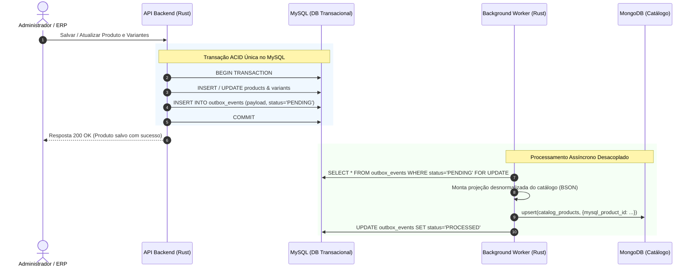

# Estudo Arquitetural: Implementação de Variação de Produtos com Persistência Poliglota (MySQL + MongoDB em Rust)

---

## 1. Informações e Contextualização do Estudo
- **Tema:** Persistência Poliglota aplicada à modelagem de catálogo e matriz de variação de produtos em e-commerce.
- **Nível acadêmico/foco:** Alunos e desenvolvedores de Tecnologia da Informação que buscam compreender a transição de bancos puramente relacionais para arquiteturas híbridas modernas.
- **Tecnologias centrais:** Rust (Backend / Lógica de Domínio), MySQL (Transacional / Relacional), MongoDB (Catálogo Orientado a Documentos).
- **Cenário de Negócio:** Loja Virtual de Materiais para Construção civil (alta heterogeneidade de catálogo).

---

## 2. Introdução e Motivação

O desenvolvimento de um e-commerce moderno apresenta um dilema clássico de engenharia de software: **como modelar produtos com características físicas, comerciais e tributárias radicalmente distintas sob uma mesma base de dados?**

Em plataformas convencionais monolíticas, todas as entidades são forçadas a caber em um único banco de dados relacional. Contudo, em cenários como lojas de materiais de construção, um único catálogo pode conter:
- Tubos hidráulicos cujas variações são puramente diâmetro ($20\text{mm}, 25\text{mm}, 50\text{mm}$) e classe de pressão;
- Tintas com variações bidimensionais ou tridimensionais (Volume: $900\text{ml}, 3{,}6\text{L}, 18\text{L}$ $\times$ Acabamento: Fosco, Acetinado $\times$ Cor);
- Ferramentas elétricas com variações de tensão ($110\text{V}, 220\text{V}$, Bateria $20\text{V}$) e composição de kit (apenas máquina vs. com maleta e duas baterias);
- Pisos e revestimentos com variação de padrão, acabamento retificado e metragem por caixa.

Para endereçar esse nível de complexidade com alta performance de leitura e rigor nas transações financeiras, este estudo explora o conceito de **Persistência Poliglota** (*Polyglot Persistence*), utilizando **MySQL** para a camada transacional/fiscal e **MongoDB** para a camada de catálogo e busca multifacetada.

```
                    ┌────────────────────────────────────────────────────────┐
                    │               Aplicação Backend (Rust)                 │
                    └──────────────┬──────────────────────────┬──────────────┘
                                   │                          │
                 [Comandos / Escritas / Transações]    [Consultas Rápidas / Catálogo]
                                   │                          │
                                   ▼                          ▼
                   ┌──────────────────────────────┐   ┌──────────────────────────────┐
                   │            MySQL             │   │           MongoDB            │
                   │    (Fonte Única da Verdade)  │   │     (Read Model / Catálogo)  │
                   │                              │   │                              │
                   │ - Estoque em tempo real      │   │ - Matriz de variações (JSON) │
                   │ - Preço base e promoções     │   │ - Busca multifacetada        │
                   │ - Dados fiscais (NCM/CEST)   │   │ - Atributos flexíveis        │
                   │ - Integridade referencial    │   │ - Renderização rápida de PDP │
                   └──────────────┬───────────────┘   └──────────────────────────────┘
                                  │                                  ▲
                                  └──────── [Sincronização] ─────────┘
                                     (Outbox Pattern / Eventos)
```

---

## 3. Fundamentação Teórica: Por que Persistência Poliglota?

O termo *Polyglot Persistence*, popularizado por Martin Fowler e Pramod Sadalage (2012), preconiza que aplicações complexas não devem forçar todas as suas entidades a um único paradigma de armazenamento. Bancos diferentes possuem características matemáticas e de engenharia otimizadas para propósitos específicos.

### 3.1. O Teorema CAP e as Decisões de Arquitetura
No Teorema CAP (Consistência, Disponibilidade e Tolerância a Particionamento):
- O **MySQL** opera tipicamente com garantias **ACID** estritas (*Atomicidade, Consistência, Isolamento e Durabilidade*). Em e-commerce, o estoque físico não pode sofrer de *over-selling* (vender duas vezes o mesmo item físico por causa de inconsistência de cache).
- O **MongoDB** opera com flexibilidade do modelo documental, permitindo leituras de agregados complexos em tempo $O(1)$ sem a necessidade de múltiplos `JOINs`, favorecendo alta disponibilidade de catálogo e baixa latência de resposta na navegação do cliente.

### 3.2. Segregação de Responsabilidade de Leitura e Escrita (CQRS Lite)
Em lojas virtuais, a proporção de leitura para escrita costuma ultrapassar $100:1$ ou $1000:1$ (centenas de clientes visualizam categorias e páginas de produto para cada um que finaliza uma compra).
- **Modelo de Escrita (Write Model):** Normalizado, seguro contra concorrência e centralizado no MySQL.
- **Modelo de Leitura (Read Model):** Desnormalizado, pré-calculado e pronto para consumo no MongoDB.

---

## 4. O Problema da Modelagem de Variantes em Bancos Relacionais

Para um estudante de TI, é fundamental entender por que as tentativas convencionais de modelar variantes em bancos relacionais costumam falhar ou gerar grande débito técnico.

### 4.1. Abordagem 1: Anti-pattern EAV (Entity-Attribute-Value)
No EAV, criam-se tabelas como:
- `produtos` (`id`, `nome`)
- `atributos` (`id`, `nome_atributo` -> "Cor", "Voltagem")
- `valores_atributos` (`id`, `atributo_id`, `valor` -> "Branco", "220V")
- `produto_variacao_valores` (`produto_id`, `variacao_id`, `valor_id`)

**Problemas do EAV:**
1. **Join Hell:** Uma consulta para filtrar "Tinta Cor Branca, Acabamento Fosco, Lata de 18L" exige 5 a 8 `JOINs` internos e operações custosas de agrupamento;
2. **Perda de Tipagem:** Os valores numéricos ($18\text{L}$, $220\text{V}$, $25\text{mm}$) são convertidos em strings (`VARCHAR`), inviabilizando ordenações numéricas nativas e operadores de intervalo (`BETWEEN`) sem conversões caras;
3. **Impossibilidade de Índices Eficientes:** Dificulta a criação de índices compostos diretos sobre atributos de negócio.

### 4.2. Abordagem 2: Colunas Específicas / Tabela Monstro
Criar dezenas de colunas esparsas na tabela de produtos:
- `voltagem`, `cor`, `diametro_mm`, `volume_litros`, `tamanho_grao`, `metragem_caixa`...

**Problemas:**
- $90\%$ das colunas ficam nulas para a maioria dos produtos (um tubo de PVC não tem voltagem nem cor de acabamento);
- Cada nova categoria criada no sistema exige uma alteração no schema do banco (`ALTER TABLE`), arriscando travamento de tabela em produção.

### 4.3. Abordagem 3: Colunas JSON no MySQL
O MySQL moderno (versões 5.7+ e 8.0+) suporta colunas `JSON` e índices virtuais funcionais. Embora seja um avanço:
- Consultas complexas com múltiplos filtros facetados aninhados tornam a sintaxe SQL convoluta;
- A agregação de toda a árvore de variantes e combinações de estoque/imagens ainda gera overhead computacional significativo na CPU do banco transacional.

---

## 5. Divisão de Responsabilidades: O que vai para onde?

Para evitar ambiguidades na modelagem, definimos claramente as fronteiras de domínio entre o MySQL e o MongoDB:

| Dimensão de Dados | MySQL (Relacional / ACID) | MongoDB (Documental / Schemaless) | Justificativa Arquitetural |
| :--- | :---: | :---: | :--- |
| **Identificador do Produto Pai** | Sim (`id`) | Sim (`mysql_product_id`) | Chave canônica de correlação entre os bancos. |
| **SKU da Variante** | Sim (Chave Única) | Sim (Indexado no array) | Necessário para identificar o item físico e transacionável. |
| **Estoque Físico & Reserva** | **Fonte Primária** | Cópia Opcional (Status) | Concorrência transacional e bloqueio pessimista/otimista pertencem ao MySQL. |
| **Preço Base e Tabela Fiscal** | **Fonte Primária** | Cópia para Exibição | Cálculos fiscais, NCM, CEST e impostos exigem rigor relacional. |
| **Atributos Dinâmicos** | Apenas chave/valor chave | **Estrutura Completa** | O MongoDB permite schemas heterogêneos por categoria sem migração. |
| **Matriz de Variantes da PDP** | Não | **Sim (Agregado)** | A tela de produto precisa saber em $1$ consulta quais opções estão disponíveis e habilitadas. |
| **Busca Multifacetada (Filtros)** | Não | **Sim** | MongoDB permite queries com `$in`, `$elemMatch` e índices compostos textuais/facetados. |

---

## 6. O Cenário: Loja de Materiais para Construção

Para demonstrar a complexidade prática, analisamos três produtos típicos do nicho da construção civil:

### Caso A: Conexão Hidráulica (Variação Dimensional e Angular)
- **Produto Pai:** "Joelhaço PVC 90° Marrom Soldável para Água Fria"
- **Eixo de Variação:** Diâmetro Nominal (DN).
- **Opções:** $20\text{mm}$, $25\text{mm}$, $32\text{mm}$, $40\text{mm}$, $50\text{mm}$, $60\text{mm}$, $75\text{mm}$, $85\text{mm}$, $110\text{mm}$.
- **Comportamento Comercial:** O produto físico é simples, mas o instalador/engenheiro seleciona por medida exata. Cada medida possui peso, NCM/CEST e código de barras (EAN) próprios.

### Caso B: Tinta Acrílica Premium (Matriz Tridimensional)
- **Produto Pai:** "Tinta Acrílica Fosca Lavável Rende Muito"
- **Eixo 1 (Volume):** $900\text{ml}$ (Quarto), $3{,}6\text{L}$ (Galão), $18\text{L}$ (Lata).
- **Eixo 2 (Acabamento):** Fosco, Acetinado, Semibrilho.
- **Eixo 3 (Família de Cor):** Branco Neve, Gelo, Camurça, Palha, Cinza Urbano.
- **Regra de Negócio:** Nem todas as combinações existem (ex: certas cores só são produzidas no acabamento fosco e latas de $18\text{L}$). O MongoDB armazena a matriz exata das variantes ativas, permitindo que a interface web desabilite botões de opções inexistentes instantaneamente.

### Caso C: Ferramenta Elétrica (Tensão e Composição de Kit)
- **Produto Pai:** "Parafusadeira e Furadeira de Impacto Brushless"
- **Eixo 1 (Alimentação):** $110\text{V}$, $220\text{V}$, Bateria $20\text{V}$ Íon-Lítio.
- **Eixo 2 (Kit/Acessórios):**
  - "Apenas Máquina (Sem bateria/carregador)"
  - "Kit Básico (1 bateria 2.0Ah + Carregador)"
  - "Kit Pro (2 baterias 4.0Ah + Carregador Rápido + Maleta TSTAK)"
- **Impacto no E-commerce:** Cada kit tem dimensões de embalagem, peso de frete e custos fiscais distintos.

---

## 7. Estratégias de Sincronização entre MySQL e MongoDB

Um dos maiores desafios em arquiteturas poliglotas é **manter os bancos sincronizados sem comprometer a consistência**. Se o preço ou nome mudar no MySQL, como o MongoDB é atualizado?



### 7.1. Abordagem Inadequada: Dual-Write Ingênuo
O backend em Rust faz um `sql.execute()` no MySQL e, logo na sequência, um `collection.update()` no MongoDB.
- **Por que falha?** Se o servidor cair entre o primeiro e o segundo comando, ou se o MongoDB rejeitar a escrita por timeout, os bancos ficam desfasados permanentemente (inconsistência de dados).

### 7.2. Abordagem Recomendada: Padrão Transactional Outbox
1. Na mesma transação SQL que salva as alterações de produto e variantes, o Rust grava um registro em uma tabela auxiliar chamada `outbox_events` (com o payload do evento em JSON e status `PENDING`).
2. Se a transação der *rollback*, o evento é descartado junto. Se der *commit*, a garantia ACID do MySQL assegura que o evento existe.
3. Um processo em segundo plano (em Rust, utilizando *Tokio tasks* ou um serviço worker desacoplado) lê a tabela `outbox_events`, transforma a estrutura relacional no documento denormalizado do catálogo e realiza o `upsert` no MongoDB.
4. Ao concluir, marca o evento como `PROCESSED`.

---

## 8. Vantagens e Trade-offs da Arquitetura

### Vantagens
1. **Performance Extrema de Leitura:** A página do produto (PDP) busca um único documento JSON/BSON no MongoDB contendo toda a árvore de variantes, fotos, especificações e status, eliminando dezenas de `JOINs`.
2. **Segurança Transacional:** Checkout, reserva de estoque, controle de pedidos e notas fiscais continuam respaldados pela integridade referencial do MySQL.
3. **Escalabilidade e Flexibilidade:** A introdução de novas categorias com atributos inéditos (ex: pisos que requerem índice PEI e absorção de água) não exige migrações ou travamentos de tabelas no MySQL.

### Trade-offs / Desvantagens
1. **Complexidade Operacional:** O time precisa gerenciar dois bancos de dados, backups distintos e rotinas de monitoramento para ambos.
2. **Consistência Eventual:** Há um pequeno intervalo de tempo (milissegundos a poucos segundos) entre a alteração no MySQL e a atualização no MongoDB. Para o catálogo de e-commerce, isso é amplamente aceitável no mercado.
3. **Curva de Aprendizado em Rust:** Manipular simultaneamente drivers relacionais assíncronos (`sqlx`) e drivers orientados a documentos (`mongodb`), além de gerenciar serialização (`serde`) e tipos fortes.

---

## 9. Roteiro de Estudo Recomendado para o Aluno de TI

Para dominar este ecossistema, sugere-se seguir a seguinte trilha de aprendizado:
1. **Modelagem Relacional Avançada:** Compreender chaves estrangeiras, índices compostos e o padrão Mestre-Detalhe (Produto Pai vs. SKU Variante).
2. **Modelagem NoSQL Orientada a Agregados:** Aprender quando desnormalizar dados e como projetar arrays de subdocumentos no MongoDB.
3. **Padrões de Integração Assíncrona:** Aprofundar-se no *Transactional Outbox Pattern* e no conceito de *Event-Driven Architecture*.
4. **Linguagem Rust e Concorrência:**
   - Crate `sqlx`: Consultas SQL assíncronas com validação de tipagem em tempo de compilação;
   - Crate `mongodb` e `bson`: Modelagem de documentos e operações de agregação;
   - Crate `tokio`: Tarefas concorrentes para workers de sincronização.

# Referências Bibliográficas

FOWLER, Martin; SADALAGE, Pramod J. NoSQL Distilled: A Brief Guide to the Emerging World of Polyglot Persistence. 1. ed. Boston: Addison-Wesley, 2012.

GILBERT, Seth; LYNCH, Nancy. Brewer's conjecture and the feasibility of consistent, available, partition-tolerant web services. ACM SIGACT News, New York, v. 33, n. 2, p. 51-59, June 2002.

YOUNG, Greg. CQRS Documents. 2010. Disponível em: wordpress.com. Acesso em: 11 out. 2026.